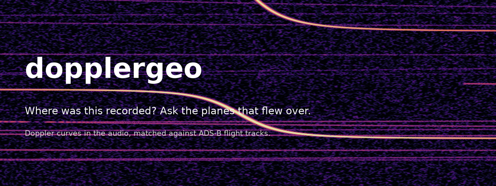
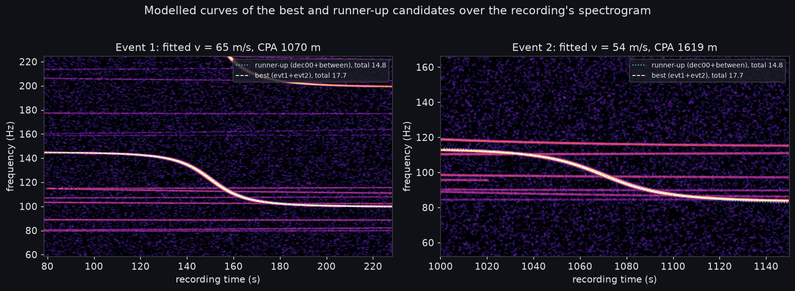
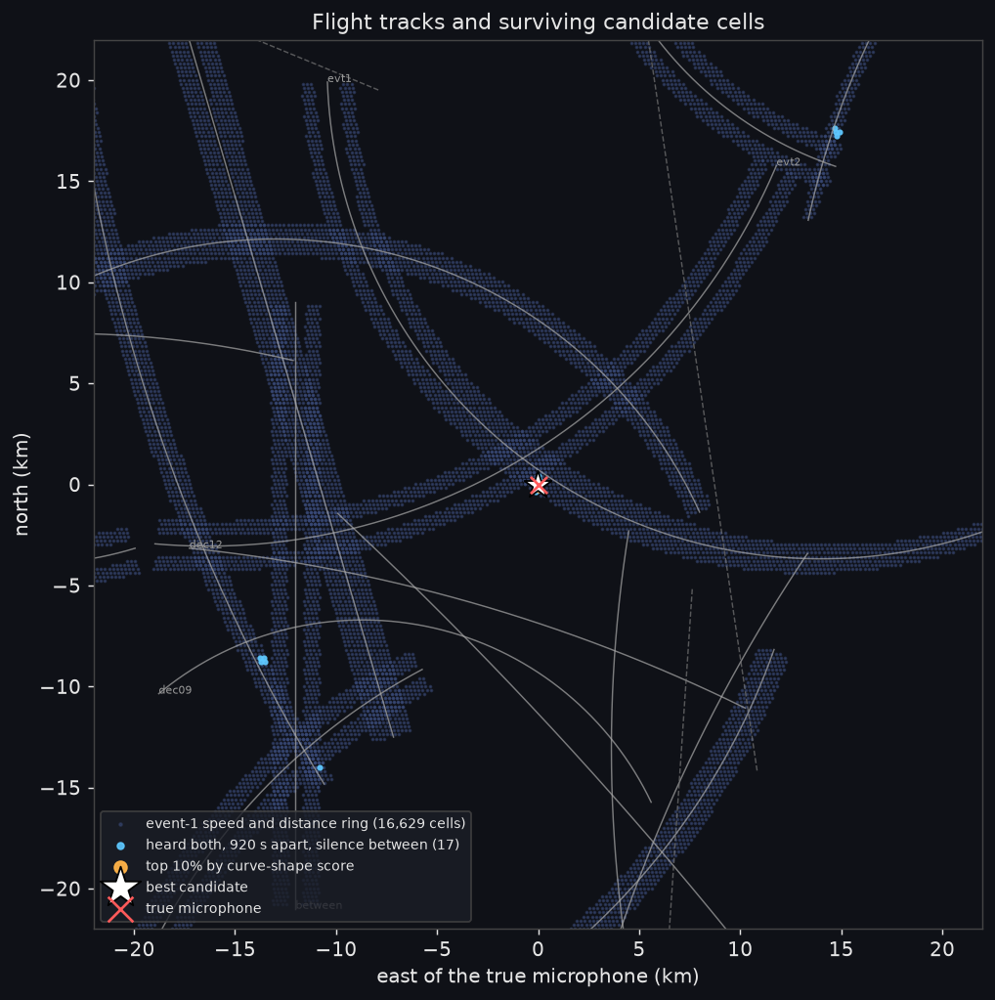
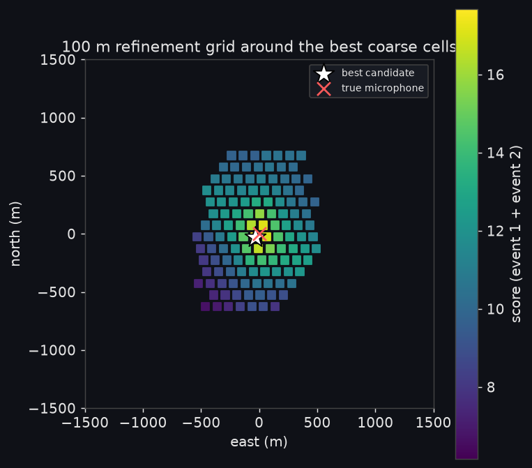
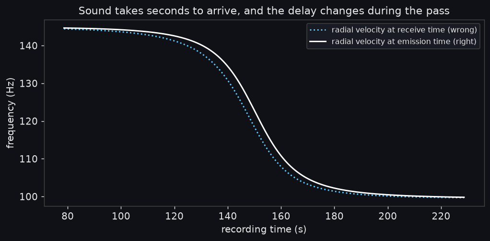
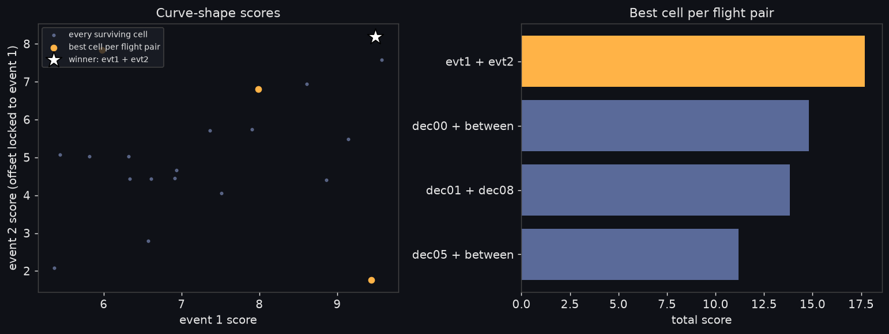
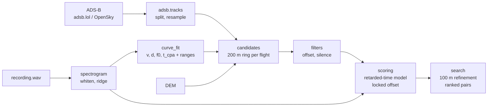

<p align="center">
  
</p>

<p align="center">
  <b>Find where a recording was made from the aircraft you can't hear in it.</b>
  <br>
  Propeller planes leave a Doppler curve in the spectrogram of almost any outdoor recording. Each curve is a fingerprint of one flight's geometry around one spot on the ground. dopplergeo measures the curves, searches a day of ADS-B flight tracks for the spot that would have heard exactly those curves, and refines the answer to a 100 m grid.
</p>

<p align="center">
  
  
  
  
  
</p>

<p align="center">
  <a href="#see-it-work">See it work</a> ·
  <a href="#how-it-works">How it works</a> ·
  <a href="#what-was-measured">What was measured</a> ·
  <a href="#architecture">Architecture</a> ·
  <a href="#run-it">Run it</a> ·
  <a href="#known-limitations">Known limitations</a>
</p>

> [!IMPORTANT]
> This is a reimplementation of a published open-source-intelligence technique, built as a study of the physics and the search. It has been verified end to end on synthetic recordings only (see [What was measured](#what-was-measured)). Nobody has run it on a real recording yet, and real audio brings wind, terrain, and microphone problems that the synthetic test does not. Use it to understand the technique and to protect yourself from it, not to find people.

## Why

A plane flying past a microphone leaves an S-shaped frequency track in the spectrogram: pitch high while it approaches, dropping through the engine's true note at the closest point, then low as it recedes. The shape is set by two numbers, the aircraft's speed and its slant distance at closest approach. The exact bends in the shape are set by the real flight path, which was being broadcast over ADS-B the whole time.

So the curve is a question with one answer. Which point on the ground, listening to which flight, hears this exact curve? With two curves in one recording, the time between them and the silence in between remove almost everything else. The YouTube investigation this reimplements located a security camera within a couple of hundred feet from a minute of audio in which the plane is inaudible to a person, knowing only the date and that it was somewhere in the continental US.

dopplergeo turns that method into a tested package: the measurement, the search, the physics model, and a synthetic benchmark that renders audio with an independent synthesiser so the model has something honest to be checked against.

## See it work

<p align="center">
  
</p>
<sub>Real output of <code>dopplergeo demo</code>. The audio is synthetic (two propeller flyovers 920 s apart, seventeen decoy flights, white noise); the curves drawn on it come from ADS-B-style tracks through the retarded-time Doppler model, placed by the search, not by the truth.</sub>

<p align="center">
   
</p>
<sub>Left: every cell that heard a plane of the right speed at the right distance (dark blue), those that also heard the second plane 920 s later with silence in between (light blue), and the top 5 % by curve-shape score (orange). Right: the 100 m refinement pass. Red cross: the true microphone. White star: the answer.</sub>

## How it works

<table>
  <tr>
    <td width="50%"></td>
    <td width="50%"></td>
  </tr>
  <tr>
    <td valign="top"><b>1. Measure the curves.</b> A high-resolution spectrogram (0.5 Hz bins, 0.25 s hops) is whitened per frequency bin so a faint tone stands out from broadband noise. A Viterbi ridge tracker follows one curve inside a box you draw; a least-squares fit of the closed-form straight-flight curve returns the aircraft's speed, its slant distance at closest approach, the emitted frequency, and when the closest approach was heard, each with a deliberately generous range.</td>
    <td valign="top"><b>2. Narrow the map.</b> Known jets are dropped by ICAO type code. For every remaining flight, every 200 m cell whose closest point of approach falls inside the measured speed and distance ranges is a candidate, tagged with the time it would have <i>heard</i> the closest approach (geometry time plus slant range over the speed of sound, with ground elevation from a DEM). Cells that heard event 1 and then event 2 at the measured offset survive; cells that would have heard any other aircraft in between do not.</td>
  </tr>
  <tr>
    <td valign="top"><b>3. Model the real curve.</b> For each surviving cell and flight pair, the exact curve is computed from the ADS-B track: for every receive time, solve for the emission time, take the radial velocity <i>then</i>, run it through the Doppler equation. The left figure shows why the shortcut fails: the propagation delay shrinks as the plane approaches and grows as it leaves, so using receive-time geometry produces a different curve, not a late one.</td>
    <td valign="top"><b>4. Score and refine.</b> Each modelled curve is laid on the whitened spectrogram and scored by the mean brightness under it. Event 1 is allowed a few seconds of alignment slop and a small frequency sweep; event 2 is locked to event 1's alignment, so a pair whose geometry gives the wrong inter-event offset loses points it cannot recover. The best coarse cells are re-scored on a 100 m grid. The right figure shows the winner separating from every other flight pair.</td>
  </tr>
</table>

Single-event mode does the same with one curve and a known recording time: the time window replaces the second curve as the constraint.

## What was measured

Numbers from `just demo` with the default seed: a synthetic 40 km × 40 km region, 20 flights (17 propeller, 3 jets), 20 minutes of 8 kHz audio with every flight rendered into it plus white noise, and nothing but that audio and the track table given to the search.

| | Event 1 | Event 2 |
|---|---|---|
| Speed, true / fitted | 64.0 / **64.6 m/s** | 53.4 / **54.5 m/s** |
| CPA slant distance, true / fitted | 1082 / **1070 m** | 1635 / **1619 m** |
| Emitted frequency, true / fitted | 118.00 / **118.00 Hz** | 96.00 / **95.93 Hz** |
| CPA heard at, true / fitted | 153.40 / **153.37 s** | 1074.77 / **1074.91 s** |

| Stage | Left |
|---|---|
| 200 m cells inside event 1's speed and distance ring, over all 17 flights | 16,629 |
| cells inside event 2's ring | 15,181 |
| cells that heard both, 921.5 ± 6 s apart | 29 |
| and heard nothing else in between | 17 |
| best candidate after the 100 m refinement, distance from the true microphone | **45 m** |
| winning flight pair's score over the runner-up pair | 17.7 vs 14.8 |
| single-event mode: one curve, recording time known to ±20 s, distance from truth | 1,455 m (right flight) |
| wall time, Apple Silicon laptop | 24 s |

- Self-measured on synthetic audio whose physics the author also wrote. The synthesiser and the search model are different formulations (waveform phase versus instantaneous frequency), which checks the Doppler and retarded-time maths, not real-world robustness.
- Across seeds 0–6 (different random decoy flights each time) the two-event search put the best candidate 45 m from the microphone on every run; on four of the seven, no other flight pair survived the offset and silence filters at all.
- The runner-up pair is two decoy flights that happen to match the measured speeds within 2 m/s and the offset within 2 s. Its curves are nearly the same shape; what separates it is a few tenths of a hertz at the asymptotes, which is why the spectrogram is built at 0.5 Hz resolution and the second harmonic is scored too.
- Single-event mode finds the right flight only when no other flight of the same speed and distance was airborne in the time window, and then leaves an along-track ambiguity of roughly the time tolerance times the aircraft speed. It picked the right flight on five of the seven seeds (441 m to 1,455 m from the truth) and a decoy on the other two.
- Tests: `just test` runs 91 tests in 9 files (all passing on November 3, 2026). They cover the closed-form curve against the track model, the synthesiser against both, ridge extraction and fitting under noise and with a ridge that wanders onto another tone, readsb trace parsing, candidate generation on sloped terrain, the offset and silence filters, scoring with the locked offset, DEM access including live terrain tiles, and the full demo.

## Design decisions

- **The curve is scored, not the fit.** The fitted speed and distance only draw a ring on the map. The decision is made by laying the modelled curve from the real track onto the spectrogram, so a plane that turned or slowed mid-pass still matches, while the straight-line fit of it merely stays in range.
- **Emission time, not receive time.** Every modelled frequency comes from the aircraft's state when the sound left it, found by solving `t_tx + range(t_tx) / c = t_rx` per sample. The naive version is wrong by several Hz over a pass, which is more than the 0.5 Hz bins can forgive.
- **Event 2 is locked to event 1.** Only the first curve may slide in time to absorb measurement error. The second must land where the flight geometry says it does. The inter-event offset is the strongest single constraint, and this is what keeps it from being fitted away.
- **Unknown aircraft types are kept.** The jet filter removes only type codes positively known to be jets. A wrong "jet" label silently deletes the right answer; a missed jet merely costs compute.
- **Ranges are generous by construction.** Every measured quantity carries a range of at least ±15 m/s, ±300 m, ±3 s, ±2 Hz, widened further by the fit covariance. Narrowing a range to make the search faster is how the true cell disappears.
- **The fit does not trust the ridge tracker.** When the plane's tone fades, the tracker drifts onto whatever is brighter nearby, usually another aircraft or a harmonic. The fit runs a Cauchy loss on the whole ridge and on three sub-windows, keeps whichever explains the most frames, and only then reports a value. Two of the seven demo seeds needed that.
- **An independent synthesiser.** Test audio is rendered as `sin(2π f0 τ(t))` with `τ` the emission time, never from the frequency model being tested.

## Architecture



| Path | What it holds |
|---|---|
| [`src/dopplergeo/acoustics.py`](src/dopplergeo/acoustics.py) | Doppler equation, closed-form straight-flight curve, cubic-spline `Trajectory`, emission-time solver |
| [`src/dopplergeo/spectrogram.py`](src/dopplergeo/spectrogram.py) | High-resolution STFT, per-bin whitening, Viterbi ridge extraction |
| [`src/dopplergeo/curve_fit.py`](src/dopplergeo/curve_fit.py) | Multi-start least-squares fit, measurement ranges |
| [`src/dopplergeo/adsb/`](src/dopplergeo/adsb/) | readsb trace parser, adsb.lol downloader, OpenSky loaders, ICAO type table, track preparation |
| [`src/dopplergeo/dem.py`](src/dopplergeo/dem.py) | Elevation providers: flat, array, GeoTIFF, AWS terrain tiles |
| [`src/dopplergeo/candidates.py`](src/dopplergeo/candidates.py) | Per-flight candidate cells with heard-CPA times |
| [`src/dopplergeo/filters.py`](src/dopplergeo/filters.py) | Inter-event offset join, silence filter |
| [`src/dopplergeo/model.py`](src/dopplergeo/model.py), [`scoring.py`](src/dopplergeo/scoring.py) | Modelled curves, spectrogram scoring with sweeps and the locked offset |
| [`src/dopplergeo/search.py`](src/dopplergeo/search.py) | Two-event and single-event searches, refinement, ranking |
| [`src/dopplergeo/synth.py`](src/dopplergeo/synth.py), [`demo.py`](src/dopplergeo/demo.py) | Independent audio synthesiser and the end-to-end benchmark |
| [`docs/DESIGN.md`](docs/DESIGN.md) | Module contracts and conventions |

## Run it

You need Python 3.12 or later, [uv](https://docs.astral.sh/uv/) and [just](https://github.com/casey/just).

```bash
just sync                                  # uv sync with the plots and dem extras
just demo                                  # synthetic end-to-end run, ~30 s, writes demo/report.json and figures
just test                                  # the test suite
```

The `justfile` keeps the virtualenv in `~/.venvs/dopplergeo`. Python 3.12 skips `.pth` files that carry the macOS hidden flag, and dotfolders under `~/Desktop` can acquire it, which silently breaks an editable install placed there. Plain `uv sync` and `uv run` work anywhere else.

On a real recording:

```bash
# 1. One day of global ADS-B history from adsb.lol (tens of GB), clipped to a region.
uv run dopplergeo fetch-adsb 2026-09-08 --out data/adsb
uv run dopplergeo load-adsb data/adsb/extracted --bbox 36 39 -123 -120 -o tracks.parquet

# 2. Terrain for the same box (needs the dem extra: uv sync --extra dem).
uv run dopplergeo fetch-dem --bbox 36 39 -123 -120 -o dem.tif

# 3. Read the two curves off the spectrogram and fit them.
uv run dopplergeo measure recording.wav --t0 400 --t1 540 --fmin 90 --fmax 160 -o event1.json
uv run dopplergeo measure recording.wav --t0 1320 --t1 1460 --fmin 80 --fmax 140 -o event2.json

# 4. Search.
uv run dopplergeo search recording.wav tracks.parquet event1.json event2.json --dem dem.tif -o ranked.csv
uv run dopplergeo search-single recording.wav tracks.parquet event1.json --time 2026-09-08T20:37:00Z --tol 60 --dem dem.tif
```

`measure` prints the fit and its ranges; widen `--t0/--t1` and `--fmin/--fmax` until the ridge tracker is clearly on the curve. OpenSky's historical database is supported through the `opensky` extra (`pyopensky`, needs an account).

## Known limitations

- **Synthetic verification only.** No real recording has been located with this code. The published investigation did it; this package has not yet.
- **Wind is ignored.** Sound travels in the air, not over the ground. A 10 m/s wind shifts the effective aircraft speed by up to 10 m/s and bends the curve. The default speed ranges absorb this; the model does not correct for it.
- **Speed of sound is a constant.** 343 m/s is 20 °C at the surface. Temperature changes it by about 0.6 m/s per degree and the ADS-B altitude is cold air. Fitted speeds inherit that error.
- **Flat-earth frames.** Each flight is modelled in a local tangent plane about its own centroid; fine below 100 km, not for transcontinental tracks.
- **Jets are only excluded when known.** The bundled ICAO type table is a curated subset. Load the OpenSky aircraft database for better coverage.
- **A whole day of the continental US is heavy.** Candidate generation is vectorised per flight, but scoring tens of thousands of cells with sweeps takes minutes, and tens of GB of ADS-B history must be downloaded and clipped first.
- **One curve is often not enough.** Single-event mode with a time known to a minute cannot tell two straight flights of the same speed and distance apart, and leaves an along-track ambiguity of about a kilometre. The published investigation got a precise answer that way because real flight paths wander; the synthetic ones barely do.
- **No automatic curve detection.** You pick the box around each curve. The ridge tracker and fit do the rest.

## License

MIT. Built by Noel Sason as a study of a technique from a published video investigation that located a security camera from the inaudible aircraft in its audio; this is an independent reimplementation, not that author's code. Most of the code was written with Claude under the author's direction.
